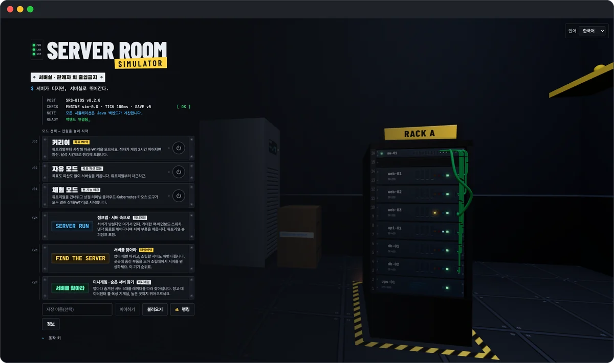
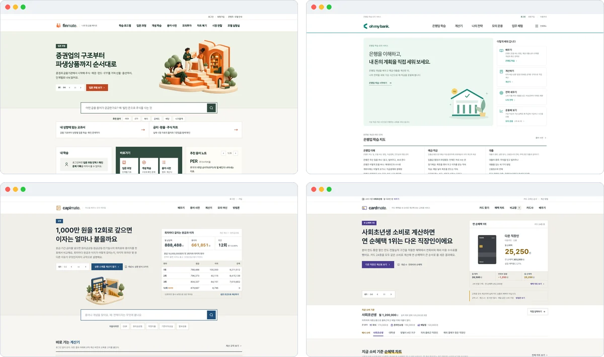

  <picture>
    <source media="(prefers-color-scheme: dark)" srcset="https://raw.githubusercontent.com/JungMK0720/JungMK0720/main/assets/header-dark.svg">
    
  </picture>

  
  
  

I wanted to know how a server holds up when things break, so I built a server room operations game and reproduced power outages, disk failures and slow connections to watch the server cope. For four finance learning services covering securities, banking, capital and cards, I pinned the money math down with versioned rule sets and golden values. I own the design, the verification and the numbers, and every figure below is recorded in its repository with the command that reproduces it.

I finished a B.S. in Applied Software at Myongji University in August 2026 and I am now in the AI, cloud and MSA program at SK AI Leader Academy (SKALA). I work mostly in Java 21, Spring Boot and PostgreSQL.

## Featured work

### Server Room Simulator

Personal project, August 2026 to present. Java 21, Spring Boot 4, PostgreSQL, WebSocket. The repository is private.

  
  <picture>
    <source media="(prefers-color-scheme: dark)" srcset="https://raw.githubusercontent.com/JungMK0720/JungMK0720/main/assets/srs-chart-dark.svg">
    
  </picture>

A 3D server room operations game where you live through power outages and disk failures. The server computes every rule, state change and failure in a 100 ms tick loop, and the browser only draws the result and sends input.

A load test showed WebSocket sends blocking the tick thread, which stretched one tick to 537 ms. I gave each connection its own virtual-thread sender with a cap on queued frames, so a slow client can no longer hold up the loop. With 100 concurrent players the longest tick is now 28.7 ms, and a command reaches the screen within 101 ms at p99.

The same seed always produces the same game, and 41,445 golden floating-point values match bit for bit. The project has 1,360 automated tests and 72 architecture decision records.

### MATE series

Personal projects, August 2026 to present. Spring Boot, PostgreSQL, React.

  
  <picture>
    <source media="(prefers-color-scheme: dark)" srcset="https://raw.githubusercontent.com/JungMK0720/JungMK0720/main/assets/mate-card-dark.svg">
    
  </picture>

Four services for learning securities, banking, capital lending and card benefits, built around numbers a learner can trust. They share one documentation scheme (UR, FR, NFR, ADR), one database strategy and one approach to auth.

Investor profile grades come from a rule engine, and an LLM only writes the explanation, which has to pass a validator. There is one calculation engine, figures live in versioned rule-set JSON, and amounts are whole won with written truncation rules. Golden values (17 cases for CapiMATE, 120 for CardMATE) are read by the docs, the code and the tests together, so any drift breaks the build. Daily closing batches are idempotent and write APIs take an Idempotency-Key.

I integrated the parallel output of 14 AI coding agents myself. Fourteen defects only showed up between work packages, such as monthly interest coming out one won short, and each one was reproduced in a test before it was fixed.

Public code: [FinMATE](https://github.com/JungMK0720/AI-invest-interest), [Oh My Bank frontend](https://github.com/oh-my-bank/frontend), [CapiMATE frontend](https://github.com/oh-my-capital/frontend). The backends are private.

### More projects

- **tradingBot**, an ETF trading bot on the Korea Investment & Securities Open API (Java 21, Spring Boot 4). The order executor never sends a duplicate order, even with rate limits, a one-token-per-minute issuing limit and delayed fills. It buys with limit orders only and never on margin, stops new buys after a 3% daily loss, sells everything 15% below the peak, and has a kill switch. Orders, fills and cancels were checked intraday on a paper account on 2026-10-16.
- **Mock Quote Server**, a controlled experiment on how quotes reach clients (Spring Boot 4.1). With the same seeded quotes and the same measuring client, I changed one thing at a time: push or polling, connection reuse, subscriber count. At 50 subscribers, push kept update latency at 3.9 ms p99 with nothing lost, while 1-second polling missed 90% of updates. Turning connection reuse off opened 4,003 connections in 20 seconds.
- **[Stock Speed Lab](https://github.com/minkyu-k530/compare-stock)**, a tool that measures how long the Toss and Korea Investment apps take to show a stock's name and price after a tap, using frame timestamps from screen recordings. The pilot came out opposite to the common impression, so I wrote down four hypotheses and fixed the main experiment design (ABBA order, 60 runs) before measuring.
- **PlantGuard AI**, a failure prediction platform for semiconductor equipment (SKALA, team of four, KPI design and modeling). A model trained on one machine raised no alert across 19 failures. Retrained on data pooled from eight machines of the same type, it warned early on 6 of 25 failures on machines it had never seen.
- **[Pipes & Filters course registration](https://github.com/JungMK0720/mju-pipes-and-filters)**, a multithreaded CLI in Java. A filter registry and component scanner built on custom annotations and reflection assemble the filters a scenario needs at runtime, so adding a job takes no pipeline code changes. Graded A+.

## Activity

  <picture>
    <source media="(prefers-color-scheme: dark)" srcset="https://raw.githubusercontent.com/JungMK0720/JungMK0720/output/calendar-dark.svg">
    
  </picture>

  <picture>
    <source media="(prefers-color-scheme: dark)" srcset="https://raw.githubusercontent.com/JungMK0720/JungMK0720/output/stats-dark.svg">
    
  </picture>
  <picture>
    <source media="(prefers-color-scheme: dark)" srcset="https://raw.githubusercontent.com/JungMK0720/JungMK0720/output/recent-dark.svg">
    
  </picture>

## Stack

  <picture>
    <source media="(prefers-color-scheme: dark)" srcset="https://skillicons.dev/icons?i=java,spring,postgres,mysql,docker,kubernetes,githubactions,gcp,prometheus,python,fastapi,react,vue,git&theme=dark">
    
  </picture>

Servers in Java 21 and Spring Boot, PostgreSQL with Flyway migrations and Testcontainers integration tests, metrics through Micrometer and Prometheus. I have packaged services as Docker images, deployed them to GKE, and set up CI/CD with GitHub Actions and Argo CD. Measurement tools and analysis are in Python.

## Education and certifications

- **Myongji University**, B.S. in Applied Software (transfer), March 2024 to August 2026. GPA 3.83/4.5, major GPA 3.92/4.5, ranked 7th of 34.
- **SK AI Leader Academy (SKALA)**, AI, cloud and MSA program, July to December 2026.
- **Certifications**: Engineer Information Processing, Big Data Analysis Engineer, SQLD, ADsP.

Other certifications (not job-related)

 

Adobe Certified Professional (Premiere Pro), Google Analytics 4, Computer Skills Level 2, Chemical Analysis Technician, Excavator Operator, Forklift Operator, Driver's License.

## Awards

- **Best Award**, One-Person Enterprise Value Chain Analysis and Business Model Competition ("Hope for Flowers"), 1st of 20 teams, for TrustBuilder (February 2026)
- **Best Active Participant Award**, MJ Major Mentors, Myongji University (December 2025)
- **Excellence Award**, Korean Tutoring, Myongji University, as team leader (December 2024)

 

Coursework and practice from SKALA live on <a href="https://github.com/minkyu-k530">minkyu-k530</a>. The activity cards are redrawn every night by <a href="https://github.com/JungMK0720/JungMK0720/blob/main/.github/workflows/profile.yml">a GitHub Actions workflow</a>.
